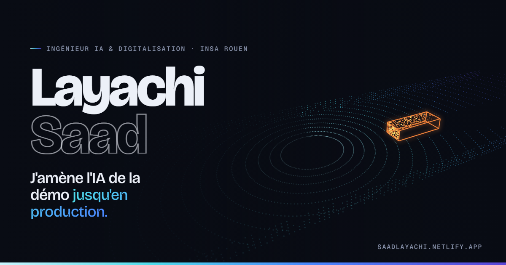

# Portfolio

Source of **[saadlayachi.netlify.app](https://saadlayachi.netlify.app)**, my portfolio as an AI engineer: three case studies with measured results, the A2RL autonomous racing project, and what I am building now. The site is in French.

## How it is built

- **One hand-written file.** [index.html](./index.html) holds the markup, styles and scripts. No framework, no build step, no dependency to install.
- **A live LiDAR viewer.** The hero is a point cloud drawn on a `<canvas>` with the 2D API and no library. Drag to turn the scene.
- **No tracking.** No cookies and no analytics. The contact form goes through Netlify Forms.
- **Small.** The whole site, images included, weighs about 0.5 MB.

## Run it

Open `index.html` in a browser. To test the contact form, deploy to Netlify: the form is detected at deploy time.

## Rights

The code is here to be read. The text, the photo and the case studies are mine; please do not reuse them.
