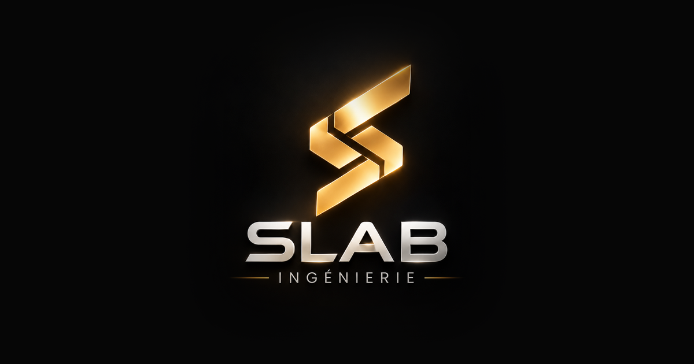

# saadlayachi.com

Source of **[saadlayachi.com](https://saadlayachi.com)**, my site as an engineer and as the founder of SLAB Ingénierie: what I have delivered, what I do for businesses, and my story. The site is in French.

## How it is built

- **One hand-written page.** [public/index.html](./public/index.html) holds the markup, the styles and a few lines of script. No framework, no build step, no dependency to install.
- **One font file.** Saira, a variable font under the SIL Open Font License, served from the site itself.
- **No tracking.** No cookies, no analytics, no form: a phone number and an e-mail address.
- **Small.** The whole page, pictures included, weighs about 0.6 MB.

## Run it

Open `public/index.html` in a browser.

## Tools

- `tools/captures.mjs` takes the screenshots of the projects and of the site itself (headless Edge).
- `tools/images.py` prepares every picture of the site from its sources.

## Rights

The code is here to be read. The text, the photo, the logo and the projects are mine; please do not reuse them.
